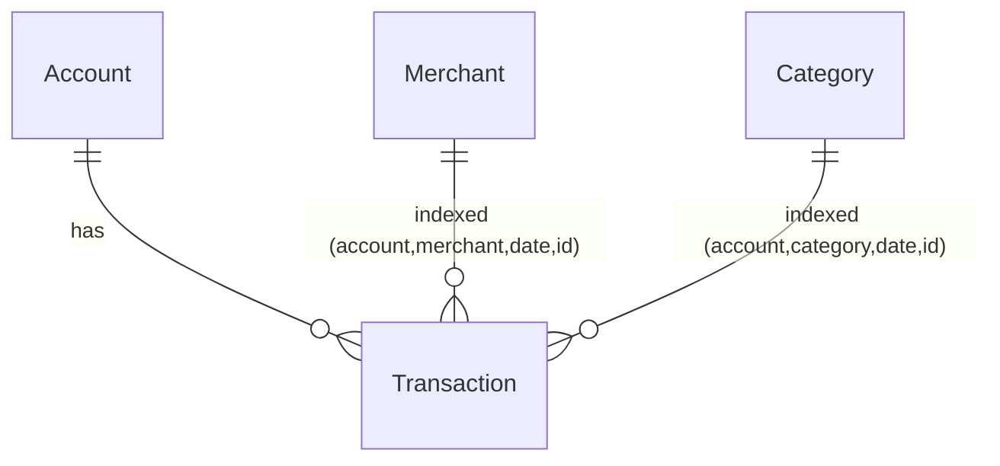

# feat/api-perf design

## Entities

New indexes on Transaction: (account,date,id), (account,merchant,date,id), (account,category,date,id).

## Flow
```mermaid
sequenceDiagram
  Client->>API: GET /accounts/{id}/transactions?search&limit&after|before
  API->>DB: merchant/category ids matching search (small tables, capped at 21 each)
  alt narrow term (<=20 matches)
    API->>DB: one indexed keyset query per match, LIMIT n+1, merged in Python
  else broad term or no search
    API->>DB: one query, select_related, keyset WHERE (date,id) > cursor, LIMIT n+1
  end
  API-->>Client: items, next_cursor, previous_cursor
  Note over API: bad cursor or both after+before -> 400; unknown account -> 404
```

## API
See backend/docs/transactions-api.md. Response changed from list to {items,next_cursor,previous_cursor}.

## Pitfalls
| Hazard | Where | Status |
|---|---|---|
| N+1 per row for category/merchant | backend/accounts/api.py list_transactions | fixed, verified (query-count test) |
| No-match search scanned the whole account (2.0s -> 84ms) | backend/accounts/api.py _rows | fixed, verified on seed DB |
| Mid-density search can still scan a lot | backend/accounts/api.py _rows | deferred, needs trigram/deadline |
| Frontend read a bare list (now follows next_cursor, 200/request, capped at 10 requests; e2e from PR #4 verified) | frontend/src/pages/TransactionsPage.tsx:81 | fixed minimally (reads `items`); only the first page loads until recurring-ui adds pagination; PR #3 vitest mocks updated to the page shape |
| Search/LIKE on 1B rows, balance aggregates | backend/docs/transactions-api.md | deferred, SQLite scale note |
