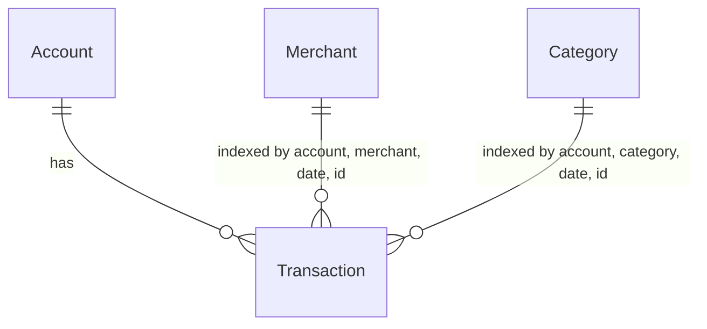
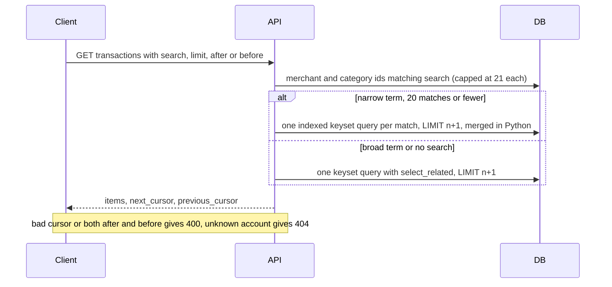

# feat/api-perf design

## Entities

New indexes on Transaction: (account, date, id), (account, merchant, date, id), (account, category, date, id).

## Flow

## API
See backend/docs/transactions-api.md. The response changed from a bare list to an object with items, next_cursor and previous_cursor.

## Pitfalls
| Hazard | Where | Status |
|---|---|---|
| N+1 per row for category and merchant | backend/accounts/api.py list_transactions | fixed, verified by a query-count test |
| No-match search scanned the whole account (2.0s to 84ms) | backend/accounts/api.py _rows | fixed, verified on the seed DB |
| Mid-density search can still scan a lot | backend/accounts/api.py _rows | deferred, needs trigram search or a statement deadline |
| Frontend read the response as a bare list | frontend/src/pages/TransactionsPage.tsx fetchAllPages | fixed: follows next_cursor (200 per request, at most 10 requests), PR #3 and #4 tests pass; accounts over 2000 rows are truncated until recurring-ui adds cursor paging |
| Substring search and balance aggregates at 1B rows | backend/docs/transactions-api.md | deferred, SQLite scale note |
