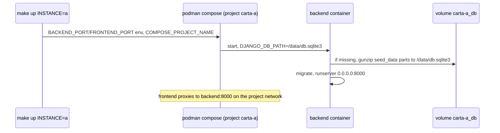

# feat/multi-instance

## Flow

## Pitfalls
| Hazard | Where | Status |
|---|---|---|
| Shared host db.sqlite3 via ./backend bind mount across instances | docker-compose.yml, settings.py | fixed (DB on per-project named volume), verified |
| Derived ports can collide (cksum mod 500) | Makefile | deferred: override with BACKEND_PORT/FRONTEND_PORT |
| Source tree bind-mounted into every instance (dev hot reload) | docker-compose.yml | deferred: intended for dev |
