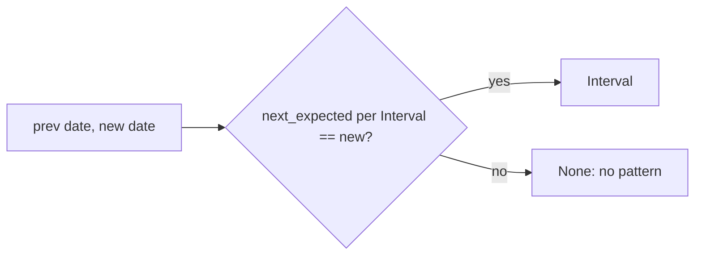
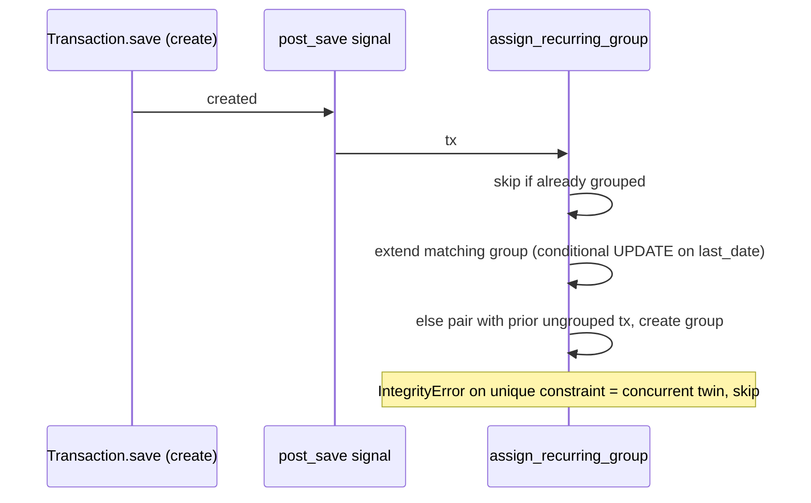
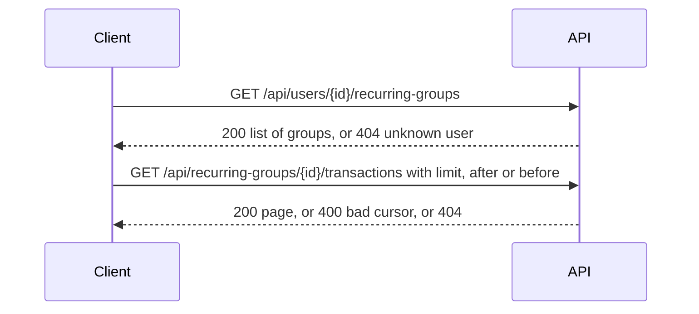
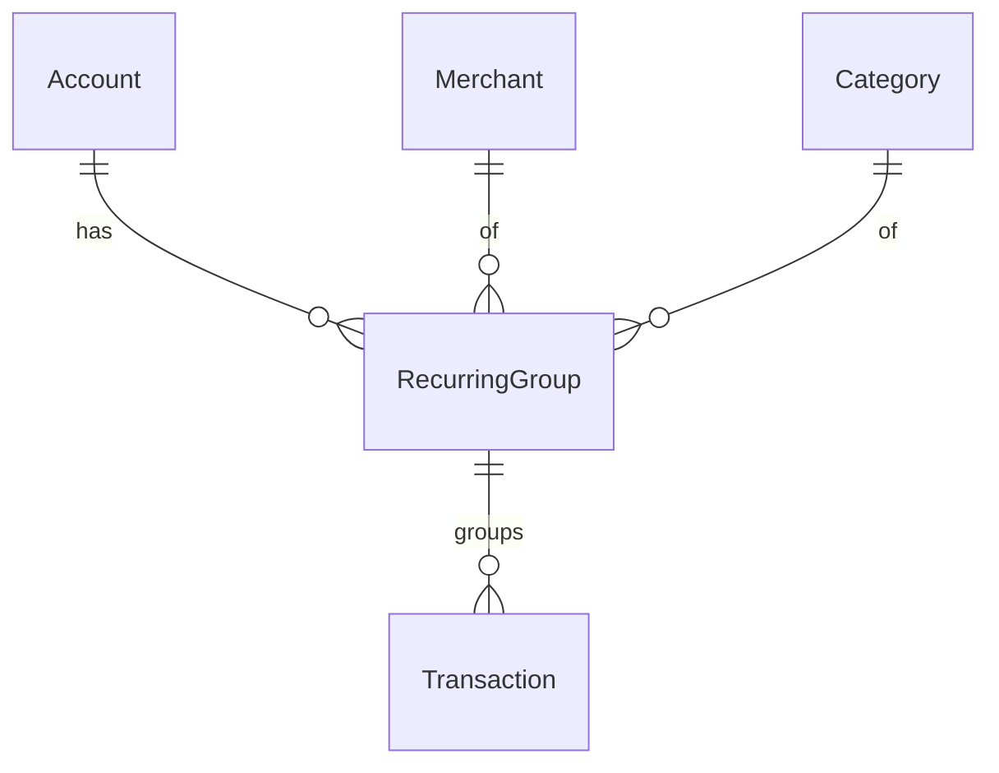

# feat/recurring-api

## Flow (slice 1: date rules)

Month-based intervals clamp the anchor day to month length (31st -> 28th -> 31st).

## Flow (slice 3: write path)

bulk_create bypasses signals; the backfill command (slice 4) covers it.

## API (slice 5)

Cursor: opaque urlsafe-base64 of `date|id`, keyset on (date, id); limit clamped to 1..200 (default 50). next_cursor null on last page.

## Backfill (slice 4)
`manage.py backfill_recurring`: for each key with >=2 ungrouped transactions, replays them in date order through `assign_recurring_group`; grouped rows are skipped, so reruns are no-ops.

## Entities (slice 2)

Merchant and category may be null (grouped as their own series). Unique constraint on (account, merchant, category, amount, type, interval, anchor_day, first_date), with NULLs coalesced to 0 makes concurrent creation of the same group fail loudly instead of duplicating.

## Pitfalls
| Hazard | Where | Status |
|---|---|---|
| Base lint is red (13 pre-existing ruff findings); lint gate scoped to changed files | .sdlc/stack.json | deferred, not ours |

## After merging api-perf
The group transactions endpoint reuses api-perf's cursor helpers and `TransactionPageOut` (one paging contract). Migrations renumbered to 0007 and 0008 on top of `0006_transaction_keyset_indexes`; `Transaction` has a single `Meta` holding all indexes.
