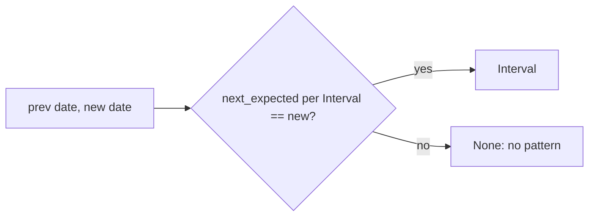
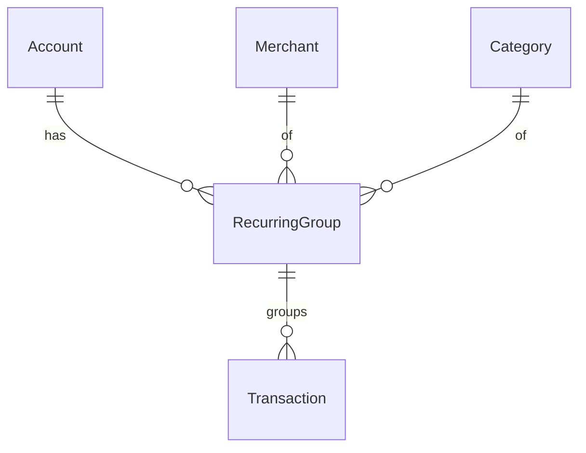

# feat/recurring-api

## Flow (slice 1: date rules)

Month-based intervals clamp the anchor day to month length (31st -> 28th -> 31st).

## Entities (slice 2)

Unique constraint on (account, merchant, category, amount, type, interval, anchor_day, first_date) makes concurrent creation of the same group fail loudly instead of duplicating.

## Pitfalls
| Hazard | Where | Status |
|---|---|---|
| Base lint is red (13 pre-existing ruff findings); lint gate scoped to changed files | .sdlc/stack.json | deferred, not ours |
