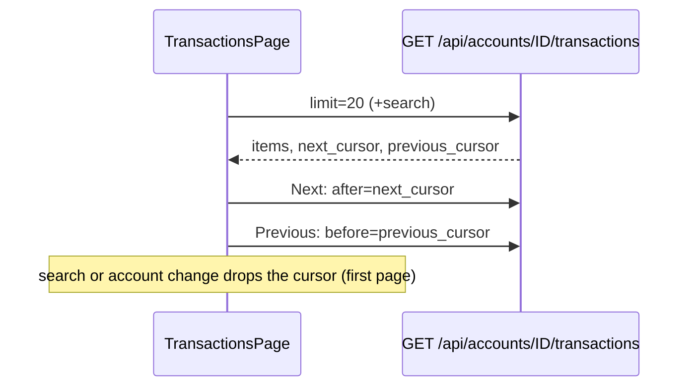
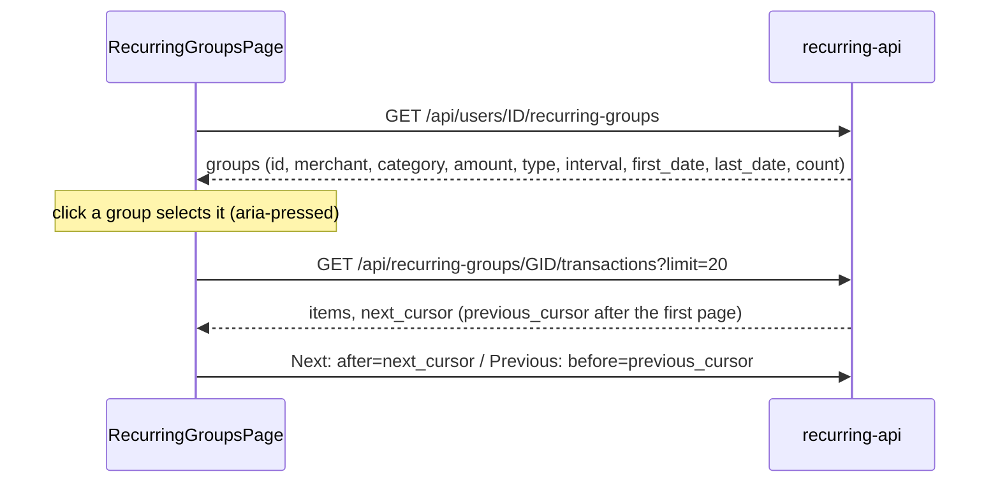

# feat/ui

## Flow: transactions paging

No total count or page numbers: the API returns none (a count is a full scan at scale).

## Flow: recurring groups (/users/ID/recurring)

Built against the recurring-api PR 5 contract; that branch is not merged into this one.

## Navigation
Users -> Accounts -> (account) Transactions, and Accounts -> Recurring transactions (/users/ID/recurring).
