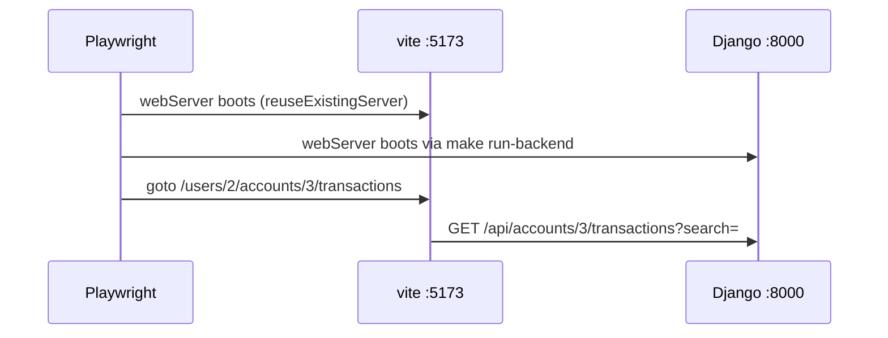

# test/e2e-playwright

Playwright E2E for the existing users → accounts → transactions flows.

| Pitfall | Where | Status |
|---|---|---|
| Account 1 (~1M rows) never returns | specs use user 2 / account 3 only | fixed (avoided) |
| Counts (247 txns, 13 pages) tied to seed DB | frontend/e2e/flows.spec.ts | deferred: seed is committed |
| Transactions API shape changes on feat/api-perf | search/pagination specs | deferred: update after that merges |
