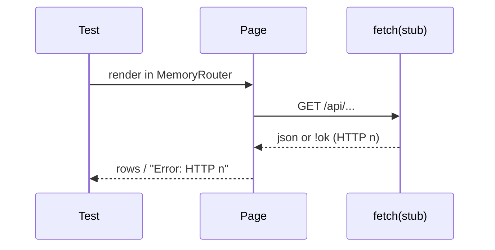

# test/frontend design

Vitest + Testing Library + jsdom for the existing pages (Users, Accounts, Transactions). `fetch` is stubbed per test.

| Pitfall | Status |
|---|---|
| TS6 `baseUrl` deprecation broke `tsc -b` (frontend/tsconfig.app.json) | fixed: removed, `paths` works alone |
| TransactionsPage tests assume bare-list API; api-perf changes it to cursor pages | deferred: tests only cover code at clone time |
